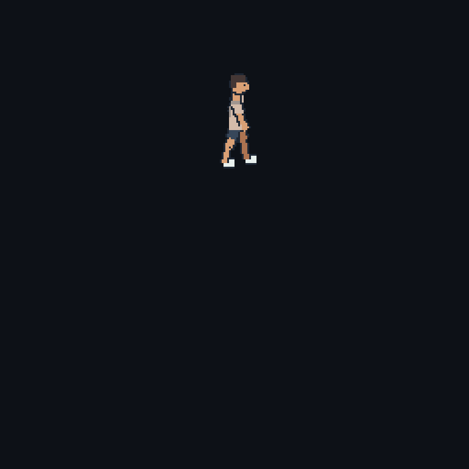

# Git Runner

A single pixel runner moving around an empty dark canvas. His pose turns with
the circular route. Built with Python, Pillow and GitHub Actions.



The [daily workflow](https://github.com/abhishekbaloria/git-runner/actions/workflows/runner.yml)
reads GitHub activity for **abhishekbaloria** and regenerates this GIF. The same
image is embedded on [my profile](https://github.com/abhishekbaloria).

## Run locally

Use Python 3.11 or newer:

```bash
python -m pip install -r requirements.txt
python main.py
```

Open `output/runner.gif` or `output/preview.html`. This local preview uses sample
activity and makes no network requests. `--demo walk` and `--demo rest` preview
the other states.

```bash
python main.py --demo walk
python main.py --demo rest
```

## Use live activity

The GitHub workflow uses its built-in token. For local use, set `GH_TOKEN` or
`GITHUB_TOKEN` in your environment. Do not commit tokens or put them in code.

```bash
python -m git_runner --username abhishekbaloria --exclude-repository git-runner --output output
```

To replay a saved snapshot offline:

```bash
python -m git_runner --snapshot output/activity.json --output replay
```

## Animation rules

| Activity | State |
| --- | --- |
| 20 or more contributions in the last 7 complete UTC days | Running; 12-second lap |
| Some activity in the last 14 complete UTC days, below the running threshold | Walking; 24-second lap |
| No contributions in the last 14 complete UTC days | Standing with a breathing motion |
| Most-used language by bytes in public, owned, nonfork repositories | Shirt colour, lightened for visibility |

The artwork repository is excluded from the language calculation. If there is
no language data, the shirt uses a default mint colour. No text, stats, scenery,
road or track is drawn in the animation.

The snapshot contains 365 complete UTC days. The current day is excluded.
Contribution counts reflect what GitHub exposes to the token; private aggregate
counts can be included when visible. Source code and private repository names
are never downloaded. Repositories are paginated, with up to 100 languages
read per repository. Language bytes describe repository contents, not personal
authorship. The animation is a playful visual, not a measure of work quality.

## Daily updates

The workflow requests an update at **02:23 UTC** daily, on changes to its source
or workflow, and when run manually from Actions. GitHub may delay scheduled
jobs or pause schedules in inactive public repositories. Output commits use the
GitHub Actions bot. Only changed output is committed.

To embed the runner elsewhere:

```html
<a href="https://github.com/abhishekbaloria/git-runner">
  
</a>
```

## Export a video

Install [FFmpeg](https://ffmpeg.org/download.html), then add `--mp4`:

```bash
python main.py --mp4
```

For a video based on live data, combine `--username abhishekbaloria` with `--mp4`
after authenticating. The default video is a sample demonstration; a posted
video is a snapshot and does not update later.

## Checks

```bash
python -m unittest discover -s tests -v
```

Checks cover activity thresholds, complete-day streaks, missing days, language
pagination, invalid input, exact loop boundaries and the character's route.
The collector's unit tests use mocked GitHub responses. The deployed workflow
also checks actual collection and rendering.

The drawing uses a 256 x 256 pixel canvas enlarged to 768 x 768 with
nearest-neighbour scaling. The runner stays upright as his face, shoulders and
limbs turn in the ground plane.

## Inspiration

Inspired by Anthony Yalong's [git-koi](https://github.com/yalongwastaken/git-koi).
This is an original Python implementation and runner artwork; no git-koi code
or fish assets are included. [MIT license](LICENSE).
